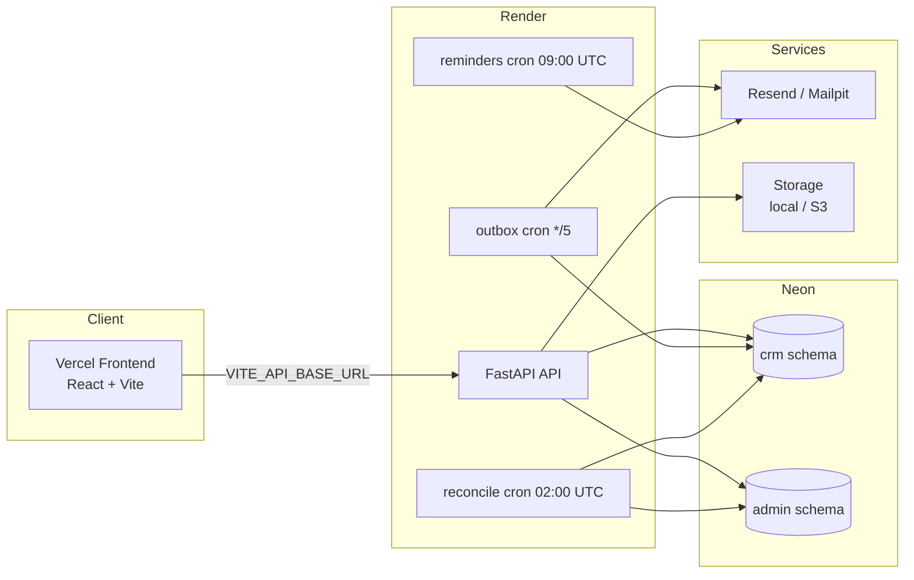

# Travel System

Internal client-management CRM for a travel company. Employees enter and manage client data — there is no public client portal. Ships end-to-end: clients, trips, visas, documents, reminders, feedback, leads, payments, invoices, and analytics.

## Stack

- **Backend**: Python 3.12, FastAPI, SQLAlchemy 2.0 (async), Alembic, Pydantic v2
- **Frontend**: React 18 + Vite + TypeScript (strict) + Tailwind, orange design tokens, dark mode
- **Data**: PostgreSQL 16 (Neon) with `crm` and `admin` schemas
- **Jobs**: `python -m app.cli` on Render cron (production); Celery worker + beat inside Docker Compose (local only)
- **Infra**: Render (API + cron), Vercel (frontend), GitHub Actions (CI), Resend (email), MinIO (local storage)

## Architecture



Production has **no Redis and no long-running worker**: every background job is a Render cron job that runs `python -m app.cli` and exits. Celery (worker + beat, Redis) exists only in the local Docker Compose stack, and its schedule mirrors the production crons.

## Quickstart (local)

```bash
cp backend/.env.example backend/.env
cp frontend/.env.example frontend/.env

make up          # postgres, redis, minio, mailpit, api, worker+beat, frontend
make migrate     # alembic upgrade head
make seed        # demo users (super admin: admin@example.com)

# or run pieces directly:
make api         # uvicorn on :8000
make test        # backend pytest
make lint        # ruff check app tests
make typecheck   # mypy app
make smoke       # against http://localhost:8000
```

- API docs: <http://localhost:8000/docs>
- Frontend: <http://localhost:5173>
- Mailpit UI: <http://localhost:8025>

Seeded local login: `admin@example.com` / `Admin123!` (see `scripts/seed.py`). Production credentials are never stored in this repository.

## Feature status

| Phase | Delivered |
|-------|-----------|
| 1 — Foundation | Auth (JWT access+refresh), RBAC, clients with AES-256-GCM passport encryption, hash lookups, masking, soft delete, audit log, app shell, theme |
| 2 — Travel documents | Trips, visas + kanban + status history, encrypted document uploads, email reminders |
| 3 — CRM | Feedback with sentiment, interaction log, lead pipeline, tags, follow-up tasks, dashboard widgets |
| 4 — Money | Payments with instalments, `PaymentProvider` (mock + provider stubs), transactional outbox, PDF invoices, admin ledger sync, nightly reconciliation |
| 5 — Analytics | Summary/trends/nationalities/revenue endpoints, analytics page (pure CSS charts), CSV export |
| 6 — Deployment | Schema-valid `render.yaml` blueprint, cron-based jobs, hardened smoke test, CI, docs |

## Quality gates

```bash
cd backend && python -m ruff check app tests   # lint
cd backend && python -m mypy app               # types (strict)
cd backend && python -m pytest -q              # 51 tests
cd frontend && npm run typecheck               # TS strict
cd frontend && npm run build                   # production bundle
python scripts/smoke_test.py https://<api>.onrender.com   # deployed stack
```

`make lint`, `make typecheck` and `make test` wrap the backend commands.

## Deployment

Deploys are automatic, not CI-driven:

- **Render** redeploys the API and its three cron jobs on every push to `main` (blueprint: [`render.yaml`](render.yaml)).
- **Vercel** redeploys the frontend on every push to `main` (`VITE_API_BASE_URL` is inlined at build time, so a URL change requires a redeploy).
- **GitHub Actions** ([`.github/workflows/ci.yml`](.github/workflows/ci.yml)) gates it all: ruff, mypy, pytest, `tsc`, Vite build, then a post-deploy smoke test on `main`.

Full sequence, environment variables and the smoke-test contract: [`docs/DEPLOYMENT.md`](docs/DEPLOYMENT.md).

## Repository layout

```
backend/            FastAPI app (api, services, repositories, models, alembic)
frontend/           React + Vite app
scripts/            seed.py, smoke_test.py
docs/               DEPLOYMENT.md, ERD.md, HOSTING_PHASE2.md (historical)
render.yaml         Render blueprint: API + cron jobs
docker-compose.yml  Local stack
```

See [docs/ERD.md](docs/ERD.md) for the data model and [PHASES.md](PHASES.md) for the phase breakdown.
