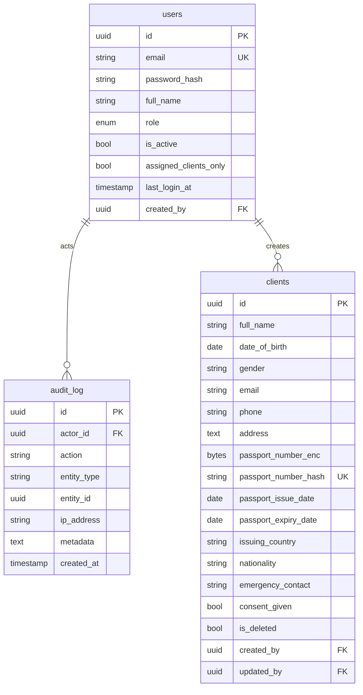

# Travel System — ER Diagram (Phase 1)

- Schemas: `crm` (all above), `admin` (ledger/invoices/revenue in Phase 4).
- Passport number is stored encrypted (`passport_number_enc`, AES-256-GCM) with a SHA-256 `passport_number_hash` for unique lookups.
- Soft delete on `clients` via `is_deleted` + `deleted_at`/`deleted_by`.
